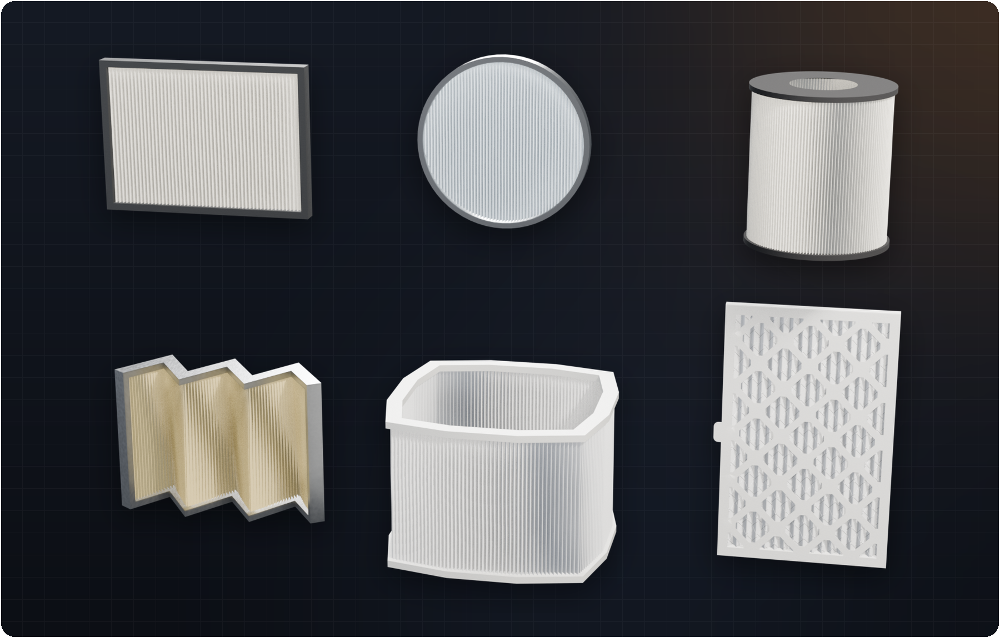
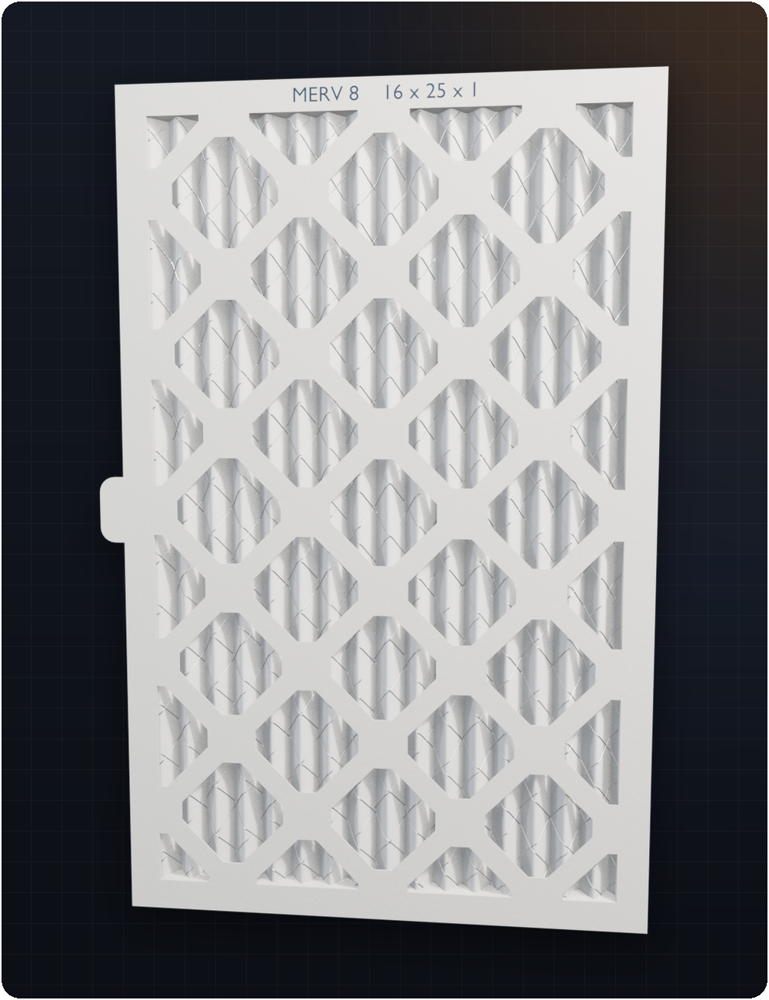
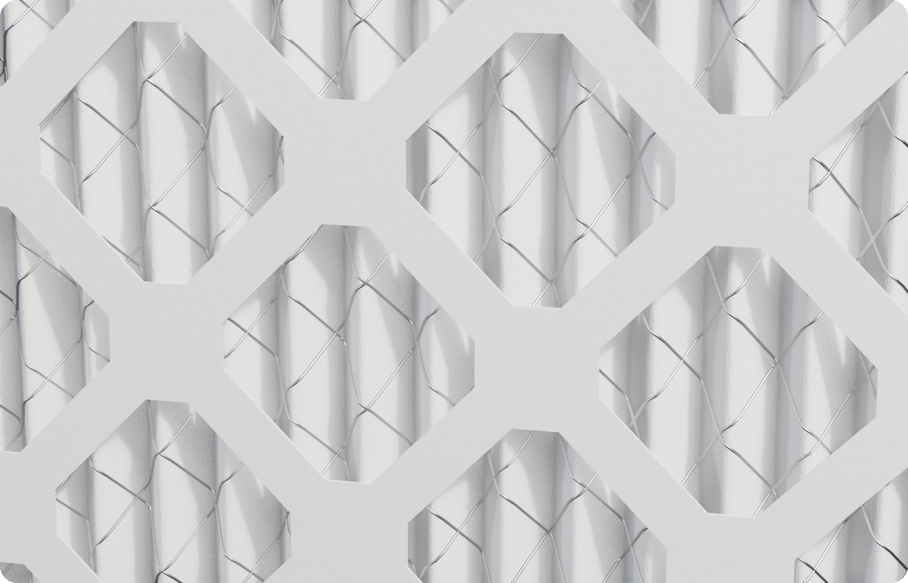
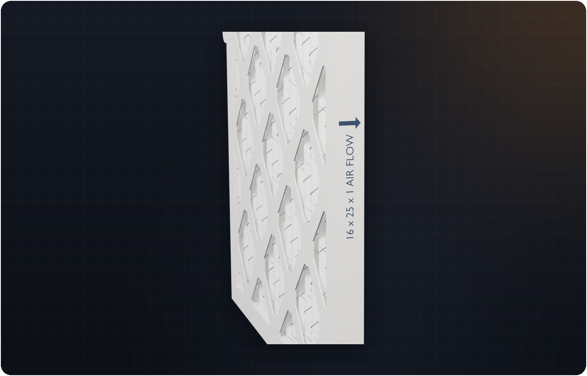
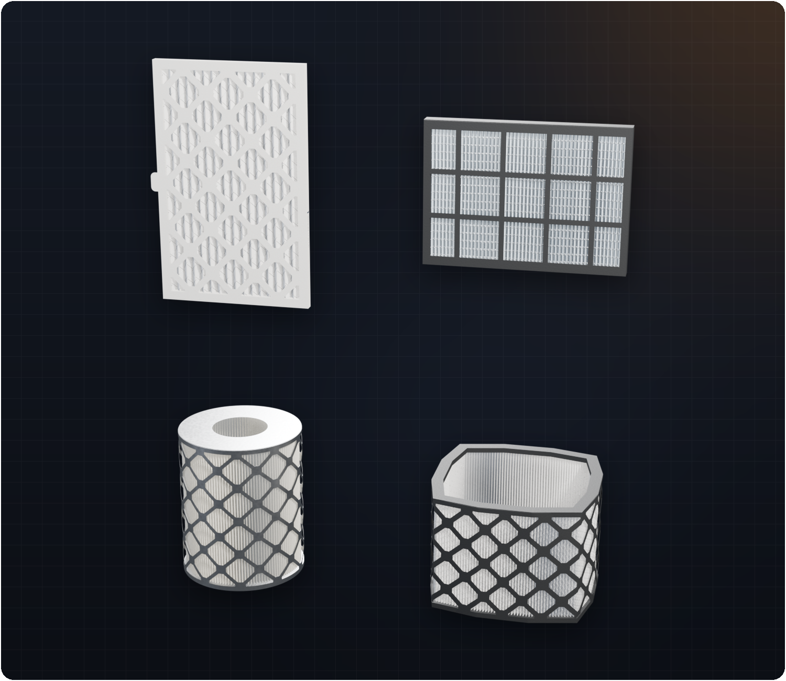
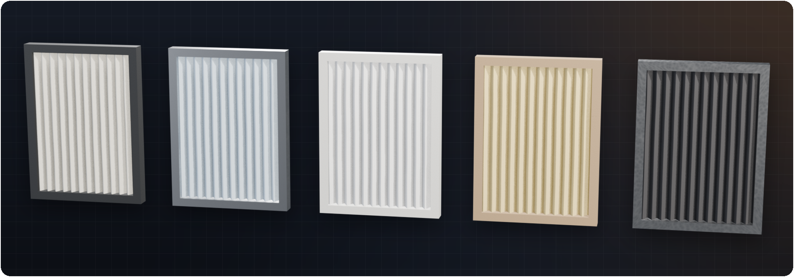
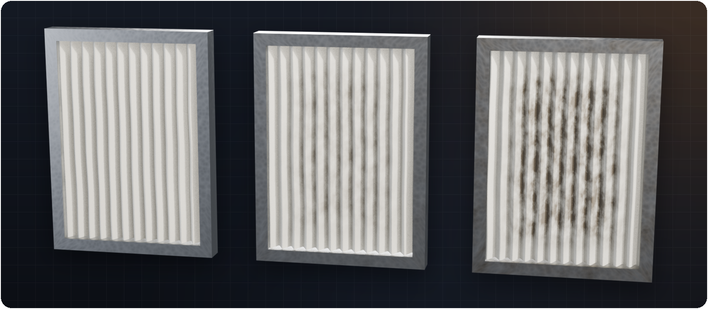
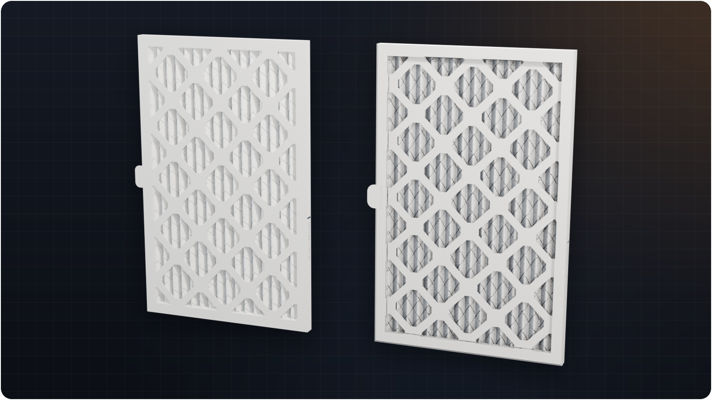
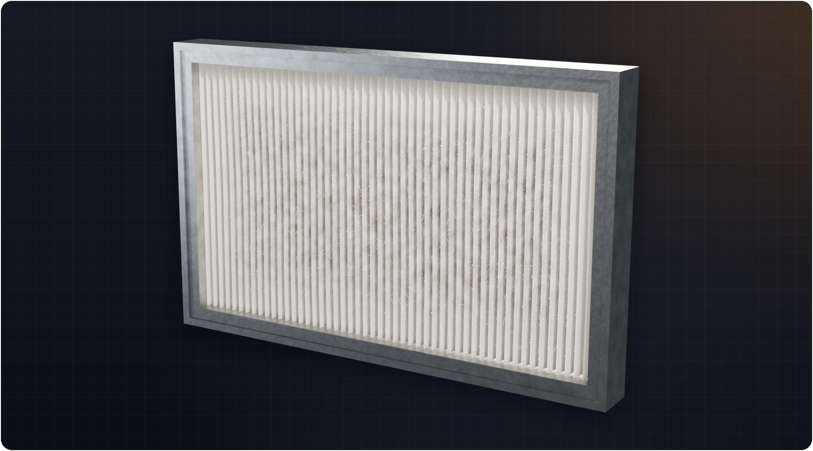
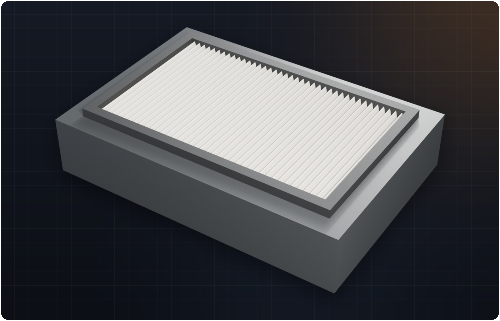

<p align="center">
  
</p>

<p align="center">
  <a href="https://github.com/Tooboi/FilterMakerPro/releases/latest"></a>
  <a href="https://github.com/Tooboi/FilterMakerPro/releases/latest"></a>
  
  
  <a href="LICENSE"></a>
  <br>
  
  
  
  
  <br>
  <a href="https://github.com/Tooboi/FilterMakerPro/releases"></a>
  <a href="https://github.com/Tooboi/FilterMakerPro/stargazers"></a>
  <a href="https://github.com/Tooboi/FilterMakerPro/issues"></a>
  <a href="https://github.com/Tooboi/FilterMakerPro/commits"></a>
  <a href="https://github.com/Tooboi/FilterMakerPro/actions/workflows/release.yml"></a>
  <a href="CONTRIBUTING.md"></a>
</p>

<p align="center">
  <b>Pleated air filters from a line, a curve, mesh edges or faces: die-cut faces, wire mesh, built-in materials, hair &amp; dust and game-ready bakes, all set from the N-panel.</b><br>
  No node setup, no modifiers to wire up. Pick a source or a ready-made shape, drag sliders, finish.
</p>

<p align="center">
  <a href="#-features">Features</a> ·
  <a href="#-gallery">Gallery</a> ·
  <a href="#-installation">Install</a> ·
  <a href="#-quick-start">Quick start</a> ·
  <a href="#-panel-reference">Panel reference</a> ·
  <a href="#-performance">Performance</a> ·
  <a href="#-faq--troubleshooting">FAQ</a> ·
  <a href="CHANGELOG.md">Changelog</a>
</p>

---

## ✨ Features

<table>
  <tr>
    <td width="33%" valign="top">
      <br>
      <b>Any source, or a ready-made shape</b><br>
      Start from a new line, any curve, mesh edges or faces, or pick <b>Add Filter Shape</b>: Panel, Round Panel, Cartridge, V-Bank, Box Wrap or a 16 x 25 x 1 in <b>Die-Cut Furnace</b> filter.
    </td>
    <td width="33%" valign="top">
      <br>
      <b>Parametric pleats</b><br>
      Density, depth, offset, angle, thickness, plus ridge and valley bevel with cuts. Goes from sharp paper folds to soft rounded media.
    </td>
    <td width="33%" valign="top">
      <br>
      <b>Clean topology, real UVs</b><br>
      A structured quad grid with welded seams, and UVs unrolled across the folds: textures keep their size on every flank, frame and cap (Real-World Size or Fit 0-1).
    </td>
  </tr>
  <tr>
    <td valign="top">
      <br>
      <b>Borders, faces and caps</b><br>
      Flat, Chamfer, Round or Lip frames; end caps for cartridges; a <b>die-cut board face</b> with diamond or square openings; pull tabs. Pleat ends never clip through.
    </td>
    <td valign="top">
      <br>
      <b>Built-in materials &amp; dirt</b><br>
      Paper, Synthetic, HEPA, Fibreglass, Carbon media and seven frame materials, all procedural. One <b>Dirt</b> slider dirties the middle and the folds and keeps the frame edge clean.
    </td>
    <td valign="top">
      <br>
      <b>Wire, print, hair &amp; dust</b><br>
      Wire mesh pleated with the media, printed size labels and airflow arrows, and a Geometry Nodes scatter of hair and dust that every filter shares.
    </td>
  </tr>
  <tr>
    <td valign="top">
      <br>
      <b>Game-ready in one click</b><br>
      A low-poly copy (pleated or a flat card), UVs packed into 0-1, Normal / AO / Color / Roughness baked from the full filter, and FBX or glTF export.
    </td>
    <td valign="top">
      <br>
      <b>Boolean cutter</b><br>
      Cut the source mesh with a box, an envelope of the pleated form or any object, so the filter sits in its housing. Applied when you finish.
    </td>
    <td valign="top">
      <br>
      <b>Presets, live and fast</b><br>
      Seven built-in looks and your own. Edits regenerate as you drag; hair, dust and wear sliders update in under 150 ms.
    </td>
  </tr>
</table>

## 🖼 Gallery

<p align="center"></p>
<p align="center"><sub><b>Add Filter Shape.</b> Panel, Round Panel, Cartridge, V-Bank, Box Wrap and Die-Cut Furnace, each one click at the 3D cursor.</sub></p>

### Die-cut faces, wire mesh and print

<table>
  <tr>
    <td width="42%"></td>
    <td width="58%"><br><br>
    </td>
  </tr>
  <tr>
    <td align="center"><sub><b>Die-Cut Furnace.</b> Board face on both sides, a pull tab and a front label</sub></td>
    <td align="center"><sub>Wire pleated with the media · size label and airflow arrow on the frame side</sub></td>
  </tr>
</table>

<p align="center"></p>
<p align="center"><sub>Diamond or square openings work on flat panels, cartridges and box wraps; the wire can run diagonally or square.</sub></p>

### Built-in materials and dirt

<p align="center"></p>
<p align="center"></p>
<p align="center"><sub>Media: Paper, Synthetic, HEPA, Fibreglass, Carbon. Frames: Painted, Galvanised, Aluminium, Cardboard, White Board, Plastic, Rubber. <b>Dirt</b> at 0, 0.45 and 0.95.</sub></p>

### Game-ready

<p align="center"></p>
<p align="center"><sub>Left: the full filter. Right: the low-poly flat card with baked Normal, AO and Base Color maps, ready for FBX / glTF.</sub></p>

### More

<table>
  <tr>
    <td width="50%"></td>
    <td width="50%"></td>
  </tr>
  <tr>
    <td align="center"><sub><b>Curve mode.</b> A closed Bézier circle with Round border rings</sub></td>
    <td align="center"><sub><b>Face mode.</b> Four box sides, one continuous sheet</sub></td>
  </tr>
  <tr>
    <td></td>
    <td></td>
  </tr>
  <tr>
    <td align="center"><sub><b>Dusty Used.</b> Wear, dirt, hair and dust</sub></td>
    <td align="center"><sub><b>Close-up.</b> Instanced hair and dust, kept clear of the frame</sub></td>
  </tr>
  <tr>
    <td></td>
    <td></td>
  </tr>
  <tr>
    <td align="center"><sub><b>Boolean.</b> The source mesh is cut so the filter sits in its housing</sub></td>
    <td align="center"><sub><b>Topology.</b> A structured quad grid that follows the fold</sub></td>
  </tr>
</table>

### Wear that looks used

The **Wear** panel uses the same settings as Blender's Clouds texture (basis, size, depth, soft/hard), so you can go from factory-fresh to crumpled. Wear fades out under the border, so the frame always sits flat.

<p align="center"></p>

### Rotate the pleats

**Pleat Angle** turns the pleat direction on face filters, for diagonal or angled media, and the border still fits the outline.

<p align="center"></p>

> [!NOTE]
> Want something simpler, for free? **[Filter Maker Lite](https://github.com/Tooboi/FilterMakerLite)** has every source, pleat shaping, the flat border and the Boolean tool. Filters made in Lite open in Pro unchanged.

---

## 📦 Installation

> **Requirements:** Blender **4.2 LTS or newer**. Developed and tested on **Blender 5.2 LTS**. The hair and dust scatter uses Geometry Nodes rotation nodes, which older versions don't have.

**Option A: as an extension (Blender 4.2+)**

1. Download `FilterMakerPro-x.y.z.zip` from the [latest release](https://github.com/Tooboi/FilterMakerPro/releases/latest).
2. Drag the zip into Blender, **or** go to *Edit → Preferences → Get Extensions → ⌄ → Install from Disk…*
3. Open the sidebar in the 3D Viewport with <kbd>N</kbd> and pick the **Filter Maker** tab.

**Option B: as a legacy add-on**

1. *Edit → Preferences → Add-ons → ⌄ → Install from Disk…*, then choose the zip.
2. Enable **Object: Filter Maker Pro**.

**Option C: from source (for development)**

```bash
git clone https://github.com/Tooboi/FilterMakerPro.git
# Windows: link the clone into your add-ons folder
set ADDONS=%APPDATA%\Blender Foundation\Blender\5.2\scripts\addons
mklink /J "%ADDONS%\FilterMakerPro" FilterMakerPro
```

Restart Blender and enable the add-on. After pulling changes, use *Reload Scripts* (<kbd>F3</kbd> → "Reload Scripts").

---

## 🚀 Quick start

<p align="center"></p>

### Four ways to create a filter

<p align="center"></p>

| I want… | Do this |
|---|---|
| **A ready-made filter** | Click **Add Filter Shape** and pick Panel, Round Panel, Cartridge, V-Bank, Box Wrap or Die-Cut Furnace. |
| **A flat strip / quick test** | Click **New Filter Line**. An editable curve appears at the 3D cursor; click **Edit** next to *Live curve guide* to reshape it, and the filter follows. |
| **A filter along a path or ring** | Select a curve (e.g. a Bézier circle) → **From Curve / Edges**. Set **Height** and **Height Direction** (X, Y, Z). |
| **A filter that fills a shape** | Select a mesh, go to Edit Mode, select faces → **From Faces**. Adjacent faces become one continuous sheet. |
| **A filter from a wire outline** | Select mesh edges in Edit Mode → **From Curve / Edges**. |

Then work down the panel: **Pleats → Pleat Bevel → Wear → Border → Face, Wire & Print → Hair / Dust → Materials**. When you're happy, click **Finish (Bake)**, or **Make Game-Ready** for a real-time copy.

> [!TIP]
> On a heavy filter, turn off **Live** in the header, change several settings, then press the refresh button once.

---

## 🎛 Panel reference

All controls live in **3D Viewport → Sidebar (N) → Filter Maker**. Each section has its own sub-panel with a line-art icon.

<details>
<summary><b>Header</b>: source, Live, Randomize, stats</summary>

| Control | What it does |
|---|---|
| New Filter Line | Creates an editable curve at the 3D cursor and builds a filter from it. |
| From Curve / Edges · From Faces | Builds a filter from the active curve or from your Edit Mode selection. |
| Live / ⟳ | Regenerate while dragging, or update manually. |
| Randomize | New seeds for wear, hair and dust. |
| Stats | Vertex/face counts and instance counts for hair and dust. |
</details>

<details>
<summary><b>Presets</b></summary>

Built-in: **Standard Pleated**, **Clean (no wear)**, **HEPA Fine Pleat**, **Coarse Furnace**, **Sharp Paper Fold**, **Die-Cut Furnace**, **Dusty Used**.
**Save As New** stores your settings as JSON in your Blender user `scripts/presets/filter_maker_pro/` folder. Lengths are saved relative to the source size, so a preset looks the same on a small or a large filter.

<p align="center"></p>
</details>

<details>
<summary><b>Pleats</b></summary>

| Setting | Notes |
|---|---|
| Pleat Density | Pleats (one ridge + one valley) per unit length. On closed rings it snaps to a whole number of pleats, so the seam is invisible. |
| Pleat Depth | Distance from the centre line to each ridge/valley. |
| Pleat Offset | Slides the pattern by a fraction of a pleat. |
| Pleat Angle | Rotates the pleat direction on face filters. |
| Surface Detail | Cuts per unit length along the pleats. |
| Height / Height Direction | Curve and edge filters: extrusion length and X/Y/Z direction. |
| Thickness | Optional solid shell; off gives a zero-thickness sheet. |
| Smooth Face Transitions | Face filters: rounds the creases between source faces before pleating. The outer boundary stays fixed. |
| Topology | **Quads** (default) or **Triangles**. |
</details>

<details>
<summary><b>Pleat Bevel</b></summary>

<p align="center"></p>

**Ridge Bevel** and **Valley Bevel** (0–1) round the folds; **Bevel Cuts** sets how many edge loops follow each curve.

<p align="center"></p>
</details>

<details>
<summary><b>Shading</b> and <b>Wear (Clouds Displace)</b></summary>

- **Smooth Shading**, **Auto Smooth** and **Angle**.
- **Wear**: Strength, Size, Depth, Soft/Hard, Basis (Blender Original, Perlin, Voronoi, Cell…), Direction (RGB to XYZ or Normal) and Seed. These match Blender's Clouds texture in a Displace modifier.
</details>

<details>
<summary><b>Border</b></summary>

<p align="center"></p>

| Setting | Notes |
|---|---|
| Profile | Flat, Chamfer, Round or Lip. |
| End Caps / Cap Hole | Plates across the ends of ring-shaped filters (cartridges, box wraps), with an optional centre hole. |
| Width (inward) / Overhang (outward) | How far the frame reaches over the filter and beyond the source edge. |
| Bevel Size / Lip Step, Round Cuts | Profile detail. |
| Front / Back Extend | Extra frame thickness on each side of the pleats. |
| Fit To Pleats | Sizes the frame to the pleat depth. |
| Shading | **Auto Smooth** is on by default; Shade Smooth is optional. |

<p align="center"></p>
</details>

<details>
<summary><b>Face, Wire &amp; Print</b></summary>

| Setting | Notes |
|---|---|
| Face | **Diamond** or **Square** die-cut board over the Front, Back or Both sides. Openings Across, Opening Shape, Strut Width, Corner Cut, Board Thickness. Works on curved, folded and ring-shaped filters too. |
| Wire Mesh | Wires pleated with the media: Diamond or Square pattern, Spacing, Angle, Radius, Front or Back. Built as a light curve object. |
| Pull Tabs | One or two board tabs on the long sides: Width, Length, Position. |
| Printed Graphics | Size label (automatic nominal inches, for example "16 x 25 x 1", or your own text), airflow text and arrow. **Print On** the Sides, the Front or both; the front strip reads upright on the top edge and can carry its own Front Text. |
</details>

<details>
<summary><b>Hair</b> and <b>Dust</b></summary>

Both kinds are scattered by a Geometry Nodes modifier (**Filter Maker Scatter**) on one shared emitter mesh. The pieces live in two collections, **FM Hair Strands** and **FM Dust Pieces**, inside **Filter Maker Library** (coloured brown and kept at the bottom of the Outliner). Every filter in the file uses the same two collections. Strands have the same **Width** along their whole length, whatever their length, and close to a point at both ends.

Settings marked *shared* shape the common pieces, so changing them on one filter updates every filter; the rest are per filter:

| Hair | Dust |
|---|---|
| Density, Length, Width, Length Variation | Density, Size, Size Variation |
| Lift (the most a strand lifts off the surface) | Tilt Randomness |
| Curl *(shared)*, Strand Shapes | Dust Types: Flakes, Clumps, Grit, Lint *(shared)*, Piece Variants |
| Border Falloff, Viewport Display % | Border Falloff, Viewport Display % |
| Seed | Seed |

Shared: **Side** (Front, Back or Both) and **Avoid Border**.

**Strand Shapes** and **Piece Variants** are per filter: the shared collection holds as many pieces as the filter that asks for the most, and each filter picks from the first N of them.
</details>

<details>
<summary><b>Boolean</b>, <b>Materials</b>, <b>Game-Ready</b>, <b>Finish</b></summary>

- **Boolean**: cuts the *source mesh* with a **Bounding Box**, an **Envelope** (the reference shape thickened over the pleats) or any **Object**; operations are Difference, Intersect and Union, with the Exact or Fast solver. The border is not cut.
- **Materials**: pick a built-in **Media** (Paper, Synthetic, HEPA, Fibreglass, Carbon) and **Frame** (Painted, Galvanised, Aluminium, Cardboard, White Board, Plastic, Rubber), or *Custom* for your own material. **Dirt** adds procedural dirt (also exposed as the `fm_dirt` and `fm_edge` mesh attributes for your own shaders). **UVs**: Real-World Size with a Texture Size, or Fit 0-1.
- **Game-Ready**: Low-Poly Pleats or Flat Card, Texture Size, maps (Normal, AO, Base Color, Roughness), Include Hair & Dust, and FBX / glTF export. The result goes into a "*filter* Low" collection; textures are saved next to the .blend. The bake uses your GPU when one is enabled in *Preferences → System*.
- **Finish (Bake)**: applies the source Boolean, removes the cutter and turns the filter into regular objects (the filter settings are dropped).
- **Delete Filter** (trash icon): removes the filter and everything it generated.
</details>

---

## ⚡ Performance

Median time per edit on a 4-panel box wrap with border, hair and dust (Blender 5.2, measured with the bundled headless benchmark):

| Edit | 0.5.2 | 0.7.0 | Speed-up |
|---|---:|---:|---:|
| Create box wrap | 463 ms | 245 ms | 1.9× |
| Enable border + hair + dust | 598 ms | 147 ms | 4.1× |
| Wear strength slider | 585 ms | 139 ms | 4.2× |
| Hair density slider | 586 ms | **71 ms** | 8.3× |
| Dust size slider | 561 ms | **70 ms** | 8.0× |
| Pleat density slider | 642 ms | 453 ms | 1.4× |
| Thickness toggle | 713 ms | 251 ms | 2.8× |

Why it's fast: the pleated sheet is cached and only rebuilt when the geometry changes; mesh assembly and the core passes run in numpy with `foreach_set`; scatter settings are written straight into the node group, so no mesh is rebuilt; and the curve-sync handler only re-reads curves that changed. The complete Die-Cut Furnace filter (face, wire, tab and print) builds in about 0.12 s.

---

## ❓ FAQ / Troubleshooting

<details>
<summary><b>I can't see the hair or dust in the viewport.</b></summary>

Check **Viewport Display %** for each kind (renders always use 100%), make sure the emitter object is visible, and check that the viewport isn't in Solid mode with a single colour that hides small pieces. If you moved or deleted the *Filter Maker Library* collection, toggle Hair/Dust off and on to rebuild it.
</details>

<details>
<summary><b>Sliders feel slow on a big filter.</b></summary>

Pleat Density, Surface Detail and bevel cuts rebuild the whole sheet. Turn off **Live**, change what you need, then refresh once. Lower **Viewport Display %** for heavy hair/dust.
</details>

<details>
<summary><b>The pleats twist or pinch on my faces.</b></summary>

Pleats follow a surface parameterisation of the selected faces. Very long, thin or heavily triangulated selections are hardest. Try turning on **Smooth Face Transitions**, adjusting **Pleat Angle**, or splitting the selection into simpler islands.
</details>

<details>
<summary><b>What exactly does Finish (Bake) do?</b></summary>

It applies the Boolean on the source mesh, deletes the cutter and clears the filter flag, so the filter, border and emitter become regular objects. Undo works if you change your mind.
</details>

<details>
<summary><b>Something broke. How do I report it?</b></summary>

Open an [issue](https://github.com/Tooboi/FilterMakerPro/issues/new/choose) using the bug template: include your Blender version, the source type (line, curve, edges or faces) and any message from *Window → Toggle System Console*.
</details>

---

## 🗺 Roadmap

- [x] UV coordinates on the pleated sheet
- [x] Built-in materials and dirt
- [x] Game-ready export
- [x] Free edition on the [Blender Extensions platform](https://extensions.blender.org/add-ons/filter-maker-lite/)
- [ ] Faster Pleat Density rebuilds (mesh assembly and the distance pass)
- [ ] Panel screenshot / GIF walkthrough in the docs
- [ ] More filter types (bag filters, V-cell, mini-pleat)

Have an idea? [Open a feature request](https://github.com/Tooboi/FilterMakerPro/issues/new/choose).

---

## 🤝 Contributing

Bug reports, ideas and pull requests are welcome. See [CONTRIBUTING.md](CONTRIBUTING.md) for the dev setup. There is a headless test suite in [`tests/`](tests/):

```bash
blender -b --factory-startup --python tests/run_tests.py
```

It builds every filter type, checks topology (quads, loose verts, seams), the scatter set-up and the presets, renders preview images, and writes `tests/results/summary.json`.

## 📄 License

[GPL-3.0](LICENSE) © Tooboi. As a Blender add-on, Filter Maker Pro is licensed under the GPL, like Blender itself. You may use it for commercial work, and the filters you make are yours.

<p align="center"><sub>Made with Blender · If this saved you time, a ⭐ helps others find it.</sub></p>
