<p align="center">
  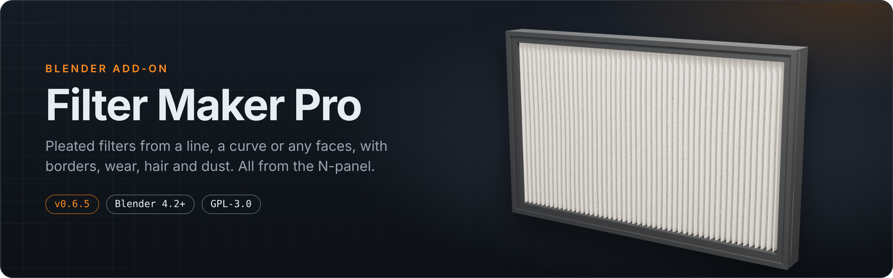
</p>

<p align="center">
  <a href="https://github.com/Tooboi/FilterMakerPro/releases/latest"></a>
  <a href="https://github.com/Tooboi/FilterMakerPro/releases/latest"></a>
  
  
  <a href="LICENSE"></a>
  <br>
  
  
  
  
  <br>
  <a href="https://github.com/Tooboi/FilterMakerPro/releases"></a>
  <a href="https://github.com/Tooboi/FilterMakerPro/stargazers"></a>
  <a href="https://github.com/Tooboi/FilterMakerPro/issues"></a>
  <a href="https://github.com/Tooboi/FilterMakerPro/commits"></a>
  <a href="https://github.com/Tooboi/FilterMakerPro/actions/workflows/release.yml"></a>
  <a href="CONTRIBUTING.md"></a>
</p>

<p align="center">
  <b>Pleated air filters from a line, a curve, mesh edges or faces, with borders, wear, hair and dust, all set from the N-panel.</b><br>
  No node setup, no modifiers to wire up. Pick a source, drag sliders, finish.
</p>

<p align="center">
  <a href="#-features">Features</a> ·
  <a href="#-installation">Install</a> ·
  <a href="#-quick-start">Quick start</a> ·
  <a href="#-panel-reference">Panel reference</a> ·
  <a href="#-performance">Performance</a> ·
  <a href="#-faq--troubleshooting">FAQ</a> ·
  <a href="CHANGELOG.md">Changelog</a>
</p>

---

## ✨ Features

<table>
  <tr>
    <td width="33%" valign="top">
      <br>
      <b>Any source shape</b><br>
      Start from a new line, any curve (open or closed), selected mesh edges, or selected faces. Neighbouring faces become <i>one continuous pleated sheet</i> that runs around corners.
    </td>
    <td width="33%" valign="top">
      <br>
      <b>Parametric pleats</b><br>
      Density, depth, offset, angle, thickness, plus ridge and valley bevel with cuts. Goes from sharp paper folds to soft rounded media.
    </td>
    <td width="33%" valign="top">
      <br>
      <b>Clean quad topology</b><br>
      Face filters are remeshed on a structured grid: 99.8–100% quads, welded seams and smooth normals across panel joins. Triangles are one click away.
    </td>
  </tr>
  <tr>
    <td valign="top">
      <br>
      <b>Borders that fit</b><br>
      Flat, Chamfer, Round or Lip frames with inward width, outward overhang and front/back extend. Pleat ends are sealed inside the frame, so nothing clips through.
    </td>
    <td valign="top">
      <br>
      <b>Wear (Clouds displace)</b><br>
      The familiar Clouds texture settings (basis, size, depth, soft/hard) displace the surface for a used look. The wear fades out under the border.
    </td>
    <td valign="top">
      <br>
      <b>Hair &amp; dust</b><br>
      Geometry Nodes scatter instances generated strand curves and dust pieces (flakes, clumps, grit, lint). Hair lies mostly flat, the two kinds never share spawn points, and both fade out near the border.
    </td>
  </tr>
  <tr>
    <td valign="top">
      <br>
      <b>Boolean cutter</b><br>
      Cut the source mesh with a bounding box, an envelope of the pleated form, or any object. It is applied when you finish.
    </td>
    <td valign="top">
      <br>
      <b>Presets</b><br>
      Six built-in looks, from <i>HEPA Fine Pleat</i> to <i>Dusty Used</i>. Save your own; presets scale with the size of the source.
    </td>
    <td valign="top">
      <br>
      <b>Live and fast</b><br>
      Edits regenerate as you drag. Scatter-only sliders update in about 5 ms, and the pleated sheet is cached between edits.
    </td>
  </tr>
</table>

### Gallery

<table>
  <tr>
    <td width="50%">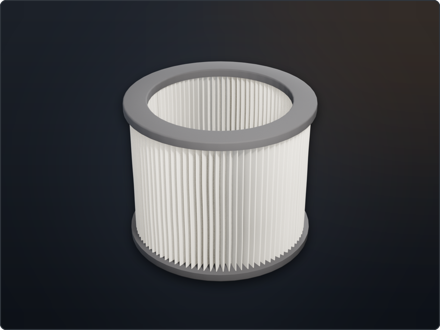</td>
    <td width="50%">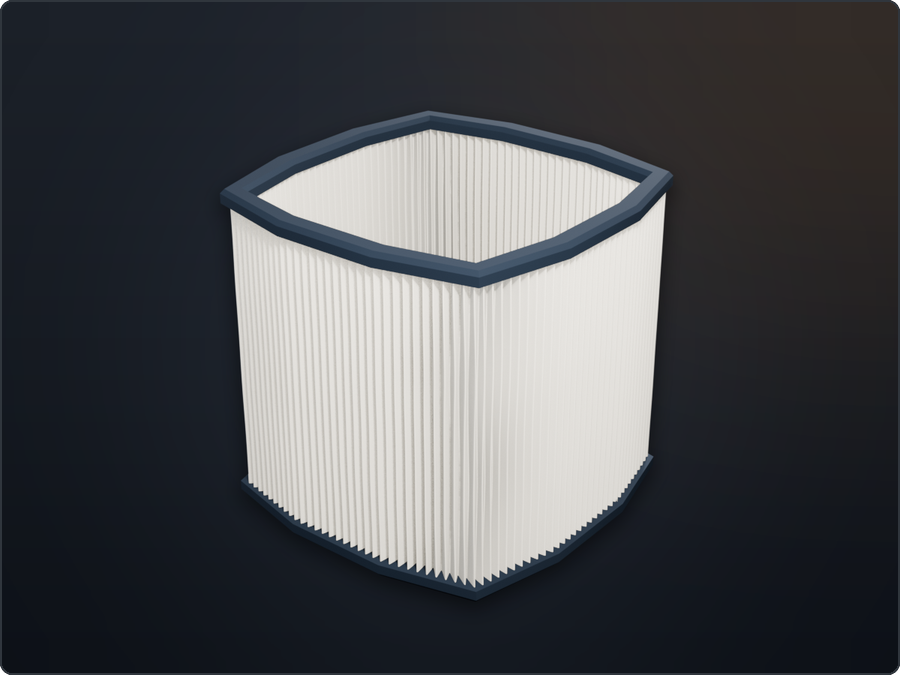</td>
  </tr>
  <tr>
    <td align="center"><sub><b>Curve mode.</b> A closed Bézier circle with Round border rings</sub></td>
    <td align="center"><sub><b>Face mode.</b> Four box sides, one continuous sheet</sub></td>
  </tr>
  <tr>
    <td></td>
    <td>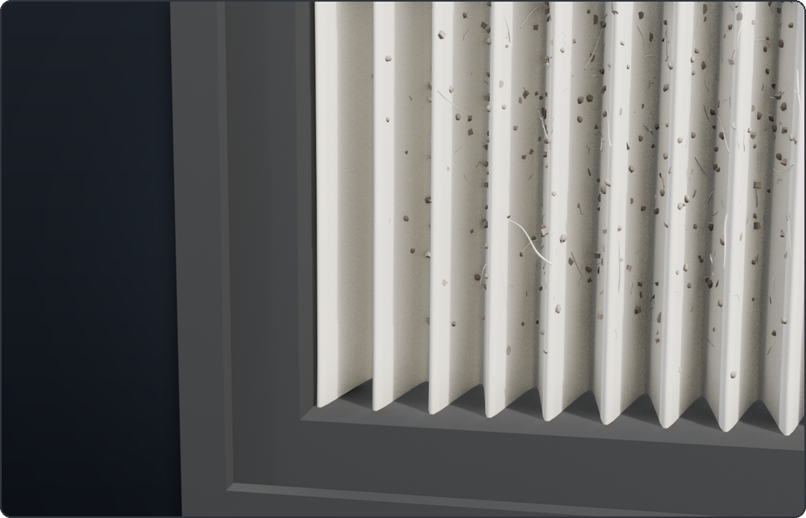</td>
  </tr>
  <tr>
    <td align="center"><sub><b>Topology.</b> A structured quad grid that follows the fold</sub></td>
    <td align="center"><sub><b>Close-up.</b> Instanced hair and dust, kept clear of the frame</sub></td>
  </tr>
</table>

### Wear that looks used

The **Wear** panel uses the same settings as Blender's Clouds texture (basis, size, depth, soft/hard), so you can go from factory-fresh to crumpled. Wear fades out under the border, so the frame always sits flat.

<p align="center">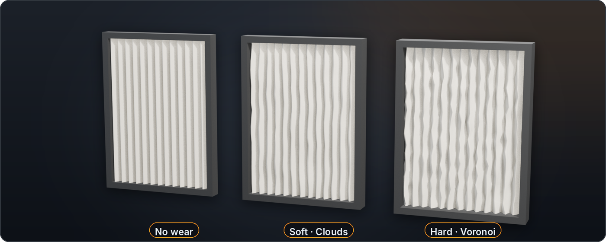</p>

### Rotate the pleats

**Pleat Angle** turns the pleat direction on face filters, for diagonal or angled media, and the border still fits the outline.

<p align="center">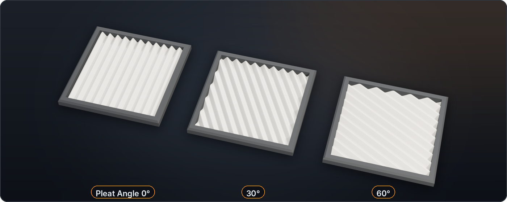</p>

---

## 📦 Installation

> **Requirements:** Blender **4.2 LTS or newer**. Developed and tested on **Blender 5.2 LTS**. The hair and dust scatter uses Geometry Nodes rotation nodes, which older versions don't have.

**Option A: as an extension (Blender 4.2+)**

1. Download `FilterMakerPro-x.y.z.zip` from the [latest release](https://github.com/Tooboi/FilterMakerPro/releases/latest).
2. Drag the zip into Blender, **or** go to *Edit → Preferences → Get Extensions → ⌄ → Install from Disk…*
3. Open the sidebar in the 3D Viewport with <kbd>N</kbd> and pick the **Filter Maker** tab.

**Option B: as a legacy add-on**

1. *Edit → Preferences → Add-ons → ⌄ → Install from Disk…*, then choose the zip.
2. Enable **Object: Filter Maker Pro**.

**Option C: from source (for development)**

```bash
git clone https://github.com/Tooboi/FilterMakerPro.git
# Windows: link the clone into your add-ons folder
set ADDONS=%APPDATA%\Blender Foundation\Blender\5.2\scripts\addons
mklink /J "%ADDONS%\FilterMakerPro" FilterMakerPro
```

Restart Blender and enable the add-on. After pulling changes, use *Reload Scripts* (<kbd>F3</kbd> → "Reload Scripts").

---

## 🚀 Quick start

<p align="center">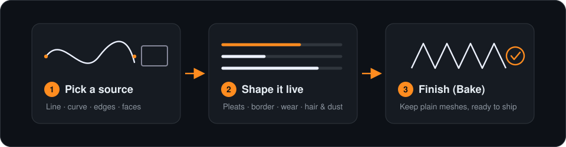</p>

### Four ways to create a filter

<p align="center">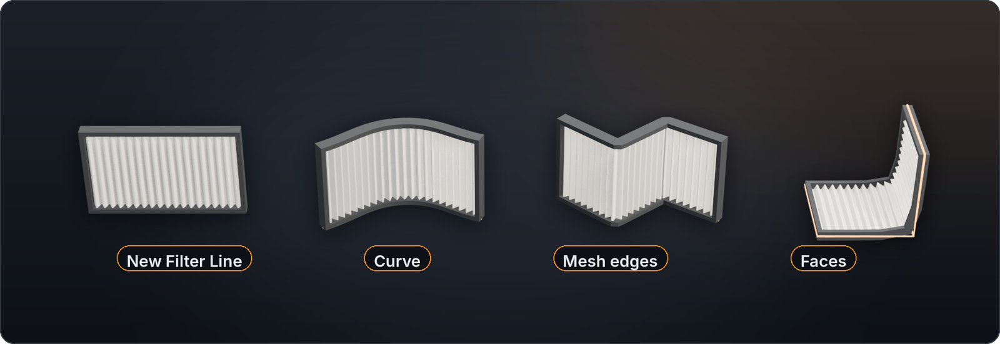</p>

| I want… | Do this |
|---|---|
| **A flat strip / quick test** | Click **New Filter Line**. An editable curve appears at the 3D cursor; click **Edit** next to *Live curve guide* to reshape it, and the filter follows. |
| **A filter along a path or ring** | Select a curve (e.g. a Bézier circle) → **From Curve / Edges**. Set **Height** and **Height Direction** (X, Y, Z). |
| **A filter that fills a shape** | Select a mesh, go to Edit Mode, select faces → **From Faces**. Adjacent faces become one continuous sheet. |
| **A filter from a wire outline** | Select mesh edges in Edit Mode → **From Curve / Edges**. |

Then work down the panel: **Pleats → Pleat Bevel → Wear → Border → Hair / Dust**. When you're happy, click **Finish (Bake)**.

> [!TIP]
> On a heavy filter, turn off **Live** in the header, change several settings, then press the refresh button once.

---

## 🎛 Panel reference

All controls live in **3D Viewport → Sidebar (N) → Filter Maker**. Each section has its own sub-panel with a line-art icon.

<details>
<summary><b>Header</b>: source, Live, Randomize, stats</summary>

| Control | What it does |
|---|---|
| New Filter Line | Creates an editable curve at the 3D cursor and builds a filter from it. |
| From Curve / Edges · From Faces | Builds a filter from the active curve or from your Edit Mode selection. |
| Live / ⟳ | Regenerate while dragging, or update manually. |
| Randomize | New seeds for wear, hair and dust. |
| Stats | Vertex/face counts and instance counts for hair and dust. |
</details>

<details>
<summary><b>Presets</b></summary>

Built-in: **Standard Pleated**, **Clean (no wear)**, **HEPA Fine Pleat**, **Coarse Furnace**, **Sharp Paper Fold**, **Dusty Used**.
**Save As New** stores your settings as JSON in your Blender user `scripts/presets/filter_maker_pro/` folder. Lengths are saved relative to the source size, so a preset looks the same on a small or a large filter.

<p align="center">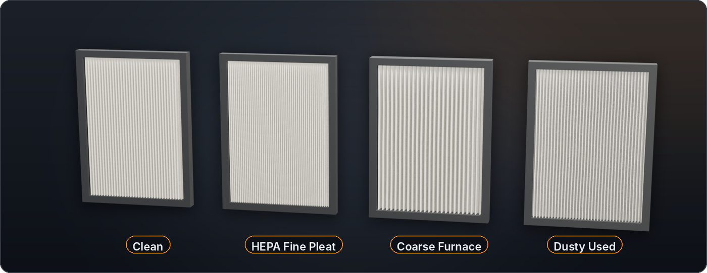</p>
</details>

<details>
<summary><b>Pleats</b></summary>

| Setting | Notes |
|---|---|
| Pleat Density | Pleats (one ridge + one valley) per unit length. On closed rings it snaps to a whole number of pleats, so the seam is invisible. |
| Pleat Depth | Distance from the centre line to each ridge/valley. |
| Pleat Offset | Slides the pattern by a fraction of a pleat. |
| Pleat Angle | Rotates the pleat direction on face filters. |
| Surface Detail | Cuts per unit length along the pleats. |
| Height / Height Direction | Curve and edge filters: extrusion length and X/Y/Z direction. |
| Thickness | Optional solid shell; off gives a zero-thickness sheet. |
| Smooth Face Transitions | Face filters: rounds the creases between source faces before pleating. The outer boundary stays fixed. |
| Topology | **Quads** (default) or **Triangles**. |
</details>

<details>
<summary><b>Pleat Bevel</b></summary>

<p align="center">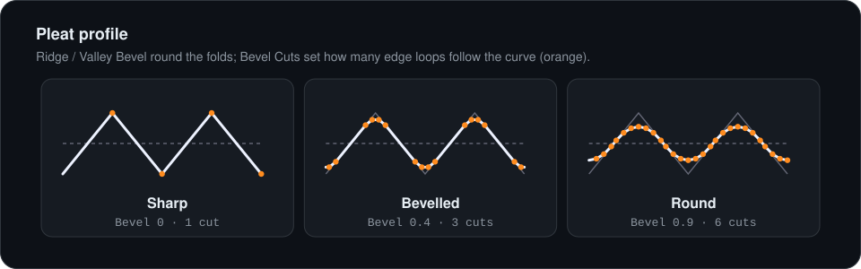</p>

**Ridge Bevel** and **Valley Bevel** (0–1) round the folds; **Bevel Cuts** sets how many edge loops follow each curve.

<p align="center">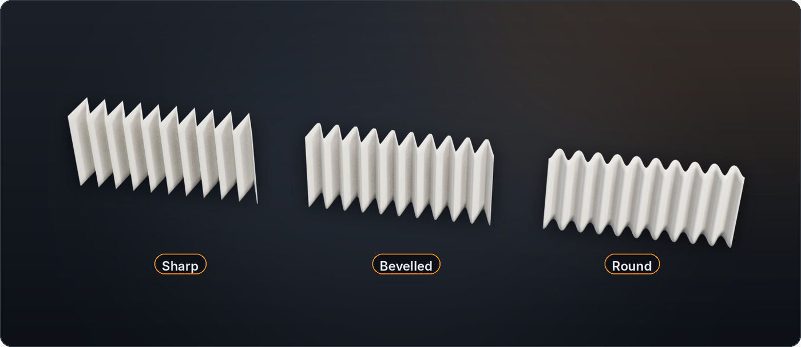</p>
</details>

<details>
<summary><b>Shading</b> and <b>Wear (Clouds Displace)</b></summary>

- **Smooth Shading**, **Auto Smooth** and **Angle**.
- **Wear**: Strength, Size, Depth, Soft/Hard, Basis (Blender Original, Perlin, Voronoi, Cell…), Direction (RGB to XYZ or Normal) and Seed. These match Blender's Clouds texture in a Displace modifier.
</details>

<details>
<summary><b>Border</b></summary>

<p align="center">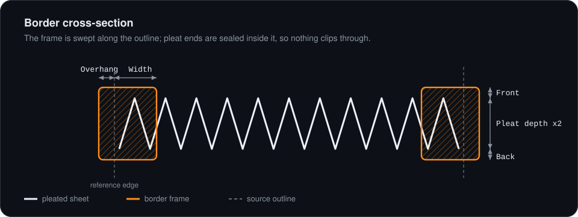</p>

| Setting | Notes |
|---|---|
| Profile | Flat, Chamfer, Round or Lip. |
| Width (inward) / Overhang (outward) | How far the frame reaches over the filter and beyond the source edge. |
| Bevel Size / Lip Step, Round Cuts | Profile detail. |
| Front / Back Extend | Extra frame thickness on each side of the pleats. |
| Fit To Pleats | Sizes the frame to the pleat depth. |
| Shading | **Auto Smooth** is on by default; Shade Smooth is optional. |

<p align="center">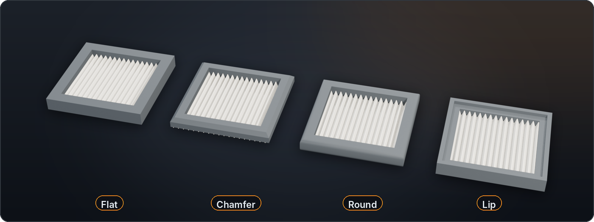</p>
</details>

<details>
<summary><b>Hair</b> and <b>Dust</b></summary>

Both kinds are instanced by a Geometry Nodes modifier (**Filter Maker Scatter**) on one shared emitter mesh. The pieces are generated into the **Filter Maker Library** collection, coloured brown and kept at the bottom of the Outliner. Each kind has its own settings:

| Hair | Dust |
|---|---|
| Density, Length, Width, Length Variation | Density, Size, Size Variation |
| Curl, Lift (the most a strand lifts off the surface), Strand Shapes | Tilt Randomness, Dust Types (Flakes, Clumps, Grit, Lint), Piece Variants |
| Border Falloff, Viewport Display % | Border Falloff, Viewport Display % |
| Seed | Seed |

Shared: **Side** (Front, Back or Both) and **Avoid Border**.
</details>

<details>
<summary><b>Boolean</b>, <b>Materials</b>, <b>Finish</b></summary>

- **Boolean**: cuts the *source mesh* with a **Bounding Box**, an **Envelope** (the reference shape thickened over the pleats) or any **Object**; operations are Difference, Intersect and Union, with the Exact or Fast solver. The border is not cut.
- **Materials**: filter, border, hair and dust. Defaults are created for you.
- **Finish (Bake)**: applies the source Boolean, removes the cutter and turns the filter into regular objects (the filter settings are dropped).
- **Delete Filter** (trash icon): removes the filter and everything it generated.
</details>

---

## ⚡ Performance

Median time per edit on a 4-panel box wrap with border, hair and dust (Blender 5.2, measured with the bundled headless benchmark):

| Edit | 0.5.2 | 0.6.3+ | Speed-up |
|---|---:|---:|---:|
| Create box wrap | 375 ms | 200 ms | 1.9× |
| Enable border + hair + dust | 508 ms | 121 ms | 4.2× |
| Wear strength slider | 510 ms | 64 ms | 8× |
| Hair density slider | 524 ms | **6 ms** | 87× |
| Dust size slider | 522 ms | **5 ms** | 104× |
| Pleat density slider | 547 ms | 318 ms | 1.7× |
| Thickness toggle | 593 ms | 153 ms | 3.9× |

Why it's faster: the pleated sheet is cached and only rebuilt when the geometry changes; the core passes run in numpy; scatter settings are written straight into the node group, so no mesh is rebuilt; and the curve-sync handler only re-reads curves that actually changed.

---

## ❓ FAQ / Troubleshooting

<details>
<summary><b>I can't see the hair or dust in the viewport.</b></summary>

Check **Viewport Display %** for each kind (renders always use 100%), make sure the emitter object is visible, and check that the viewport isn't in Solid mode with a single colour that hides small pieces. If you moved or deleted the *Filter Maker Library* collection, toggle Hair/Dust off and on to rebuild it.
</details>

<details>
<summary><b>Sliders feel slow on a big filter.</b></summary>

Pleat Density, Surface Detail and bevel cuts rebuild the whole sheet. Turn off **Live**, change what you need, then refresh once. Lower **Viewport Display %** for heavy hair/dust.
</details>

<details>
<summary><b>The pleats twist or pinch on my faces.</b></summary>

Pleats follow a surface parameterisation of the selected faces. Very long, thin or heavily triangulated selections are hardest. Try turning on **Smooth Face Transitions**, adjusting **Pleat Angle**, or splitting the selection into simpler islands.
</details>

<details>
<summary><b>What exactly does Finish (Bake) do?</b></summary>

It applies the Boolean on the source mesh, deletes the cutter and clears the filter flag, so the filter, border and emitter become regular objects. Undo works if you change your mind.
</details>

<details>
<summary><b>Something broke. How do I report it?</b></summary>

Open an [issue](https://github.com/Tooboi/FilterMakerPro/issues/new/choose) using the bug template: include your Blender version, the source type (line, curve, edges or faces) and any message from *Window → Toggle System Console*.
</details>

---

## 🗺 Roadmap

- [ ] Publish on the [Blender Extensions platform](https://extensions.blender.org/)
- [ ] UV coordinates on the pleated sheet (for paper textures and print patterns)
- [ ] Faster Pleat Density rebuilds (mesh assembly and the distance pass)
- [ ] Panel screenshot / GIF walkthrough in the docs
- [ ] Per-filter material presets (paper, synthetic, carbon)

Have an idea? [Open a feature request](https://github.com/Tooboi/FilterMakerPro/issues/new/choose).

---

## 🤝 Contributing

Bug reports, ideas and pull requests are welcome. See [CONTRIBUTING.md](CONTRIBUTING.md) for the dev setup. There is a headless test suite in [`tests/`](tests/):

```bash
blender -b --factory-startup --python tests/run_tests.py
```

It builds every filter type, checks topology (quads, loose verts, seams), the scatter set-up and the presets, renders preview images, and writes `tests/results/summary.json`.

## 📄 License

[GPL-3.0](LICENSE) © Tooboi. As a Blender add-on, Filter Maker Pro is licensed under the GPL, like Blender itself. You may use it for commercial work, and the filters you make are yours.

<p align="center"><sub>Made with Blender · If this saved you time, a ⭐ helps others find it.</sub></p>
